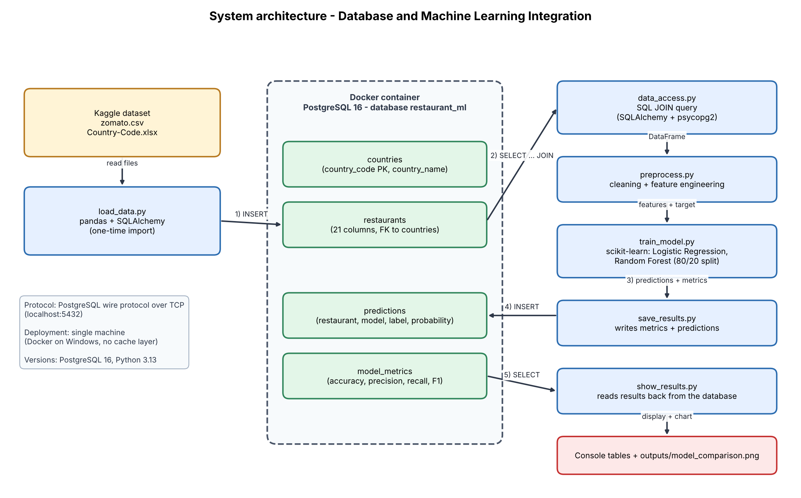
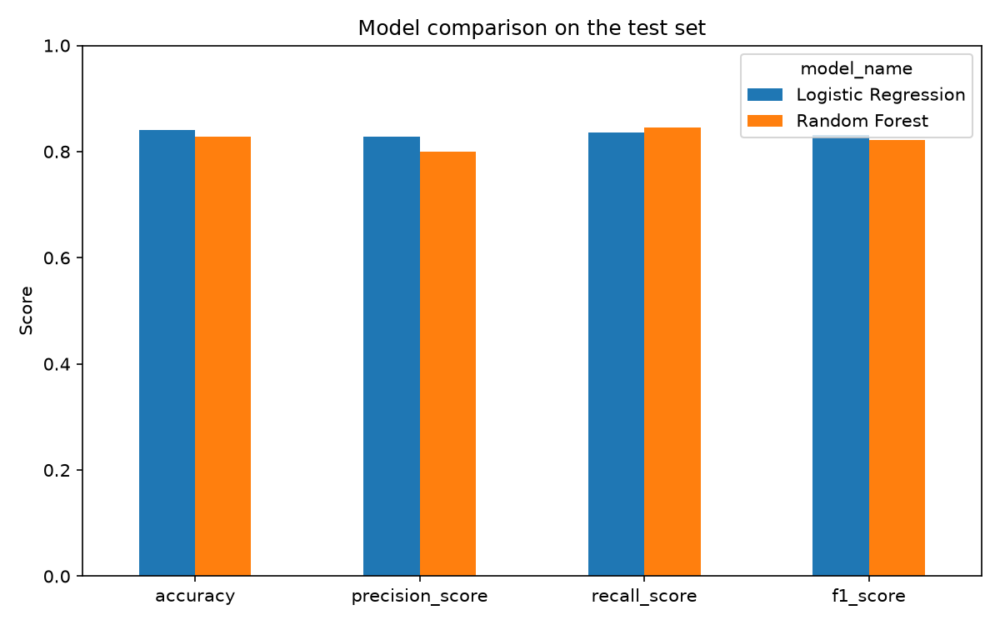

[README (3).md](https://github.com/user-attachments/files/35207098/README.3.md)
# Restaurant Rating Prediction with PostgreSQL and Machine Learning

This is my project for the Database Management Systems course. I used the Zomato restaurants dataset from Kaggle and built a model that predicts whether a restaurant has a high rating (3.5 or more).

The goal was not only to train a model, but to make the database and the model work together. The training data is read straight from PostgreSQL with a SQL query (I never export a CSV for the model), and the predictions and metrics are written back into PostgreSQL and shown from there.

I also added a small web panel (Flask, HTML, CSS and JavaScript) that shows the results from the database in a browser. It is not required by the course, I built it as an extra. It supports five languages: English, Turkish, German, Arabic and Chinese.

## Architecture



Everything runs on one machine. PostgreSQL runs in a Docker container and the Python scripts run locally in a virtual environment. They talk over TCP on `localhost:5432` using SQLAlchemy and psycopg2. There is no cache layer. The web panel also offers a small JSON API. The editable diagram is in `docs/architecture_diagram.drawio` (it opens in https://app.diagrams.net).

The data flow has seven steps:

1. `load_data.py` imports the CSV and Excel files into PostgreSQL.
2. `data_access.py` fetches the training data with a SQL `JOIN`.
3. `preprocess.py` and `train_model.py` clean the data, train the models and test them.
4. `save_results.py` writes the metrics and predictions back to PostgreSQL.
5. `show_results.py` reads the results from the database and shows them.
6. `app.py` (the web panel) reads the same tables and shows them in the browser.
7. `save_model.py` saves the trained models to a file, and the panel loads it to predict the restaurants that visitors describe on the Predict page.

## Tools

PostgreSQL 16 (Docker image `postgres:16`), Python 3.13, pandas, openpyxl, SQLAlchemy, psycopg2-binary, scikit-learn, matplotlib and Flask. The web panel is written with Jinja HTML templates, plain CSS and plain JavaScript (no frontend framework). The exact package list is in `requirements.txt`.

## Dataset

I used [Zomato Restaurants Data](https://www.kaggle.com/datasets/shrutimehta/zomato-restaurants-data) from Kaggle (the license is on the dataset page). Two files are in the `data/` folder:

- `zomato.csv`: 9,551 restaurants with 21 columns (location, cuisines, cost, price range, online delivery, rating, votes and more)
- `Country-Code.xlsx`: connects the numeric country code to the country name

These files are only used once, to fill the database. After that everything reads from PostgreSQL.

## Project files

```
restaurant-ml-project/
├── data/                    raw dataset files (only for the first import)
├── docs/                    architecture diagram (PNG and draw.io)
├── templates/               HTML pages of the web panel
├── static/                  style.css, app.js and predict.js of the web panel
├── outputs/                 chart created by show_results.py
├── sql/
│   ├── schema.sql           countries and restaurants tables
│   └── results_schema.sql   model_metrics and predictions tables
├── docker-compose.yml       PostgreSQL container
├── db.py                    database connection settings
├── inspect_data.py          quick look at the raw files (optional)
├── load_data.py             CSV and Excel -> PostgreSQL
├── data_access.py           SQL query that fetches the training data
├── preprocess.py            cleaning and feature engineering
├── train_model.py           training and testing of both models
├── save_results.py          writes metrics and predictions to PostgreSQL
├── show_results.py          reads the results back and shows them
├── benchmark_index.py       index experiment (query time with and without index)
├── benchmark_json.py        relational tables compared with JSON documents
├── run_experiments.py       cross-validation, threshold and no-votes experiments
├── app.py                   web panel (Flask routes)
├── translations.py          texts of the five languages
├── save_model.py            trains both models on all rated restaurants and saves them
├── predictor.py             loads the saved models and prepares the inputs for them
└── requirements.txt
```

## Database design

I used four tables.

`countries` is a small lookup table with `country_code` (primary key) and `country_name`.

`restaurants` has one row per restaurant and 21 columns. `restaurant_id` is the primary key and `country_code` is a foreign key to `countries`, so a restaurant cannot point to a country that does not exist. Yes/No columns are `BOOLEAN`. The rating is `NUMERIC(2,1)` with a check between 0 and 5, and the price range is `SMALLINT` with a check between 1 and 4. I added two indexes, one on `country_code` and one on `aggregate_rating`, because I filter by both.

`model_metrics` stores accuracy, precision, recall, F1, the training time and the number of test rows for each model.

`predictions` has one row for each restaurant and model: the predicted label, the probability of "high rated", the real label and an `is_test_row` flag that tells if the restaurant was kept out of training. The primary key is `(restaurant_id, model_name)`.

Why I designed it this way:

- The country name is in its own table so it is not repeated in thousands of restaurant rows.
- I kept `cuisines` as one comma-separated text column. A fully normalized design would need a cuisine table and a link table, which seemed too much for this project. I split the cuisines later, in the preprocessing step.
- The predictions are stored for all restaurants, not only the test ones, with a flag. This way the metrics can be recomputed in SQL from the stored predictions.

## How to run it

I ran everything on Windows. You need Git, Docker Desktop and Python 3.13 (a recent Python 3 should also work).

**1. Clone the repository**

```
git clone https://github.com/buyukbayraktaraleyna-cloud/restaurant-ml-project.git
cd restaurant-ml-project
```

**2. Create a virtual environment and install the packages**

```
python -m venv venv
venv\Scripts\activate
pip install -r requirements.txt
```

On macOS or Linux, use `source venv/bin/activate` instead.

**3. Start PostgreSQL**

Open Docker Desktop, wait until it says the engine is running, then run:

```
docker compose up -d
docker ps
```

`docker ps` should show a container called `restaurant_db` with the status `Up`. The settings are in `docker-compose.yml` (database `restaurant_ml`, user `student`, password `student123`, port `5432`). These are only local development credentials.

**4. Create the tables**

```
docker cp sql/schema.sql restaurant_db:/schema.sql
docker exec restaurant_db psql -U student -d restaurant_ml -f /schema.sql
```

**5. Import the dataset**

```
python load_data.py
```

It should print `Loaded 15 countries and 9551 restaurants`.

**6. Train and compare the models (optional)**

```
python train_model.py
```

This only prints the metrics, it does not save anything to the database.

**7. Save the results to PostgreSQL**

```
python save_results.py
```

It should print `Saved 2 metric rows and 14806 predictions to PostgreSQL`. This script also creates the `model_metrics` and `predictions` tables from `sql/results_schema.sql`.

**8. Show the results from the database**

```
python show_results.py
```

It prints the metrics, the confusion matrices, the most confident predictions and the most confident mistakes. It also saves a chart to `outputs/model_comparison.png`.

To check the database directly:

```
docker exec restaurant_db psql -U student -d restaurant_ml -c "SELECT model_name, accuracy, f1_score FROM model_metrics;"
docker exec restaurant_db psql -U student -d restaurant_ml -c "SELECT model_name, ROUND(AVG((predicted_label = actual_label)::int), 3) AS test_accuracy FROM predictions WHERE is_test_row GROUP BY model_name;"
```

The second query calculates the test accuracy again in SQL, using only the stored predictions.

**9. Save the trained models (needed for the Predict page)**

```
python save_model.py
```

It trains both models on all rated restaurants and saves them to `models/restaurant_models.joblib`. The file is not uploaded to GitHub (it is in `.gitignore`), so run this once on every computer before you open the Predict page. If the file is missing, the Predict page shows a message that tells you to run this command.

**10. Start the web panel (optional)**

```
python app.py
```

Then open http://127.0.0.1:5000 in the browser. Docker must be running, because the panel reads everything from PostgreSQL. Press `Ctrl+C` in the terminal to stop it.

To start over with an empty database, run `docker compose down -v` and `docker compose up -d`, then repeat steps 4 to 8 (and 9 and 10 if you want the panel). Step 4 cannot be run again on a database that already has the `predictions` table, because that table depends on `restaurants`.

## Web panel

The panel does not train anything. It only reads the tables that the scripts filled, so it shows the same numbers as `show_results.py`.

Pages:

- **Results**: the metrics of both models, the confusion matrices and a button to download all predictions as CSV.
- **Statistics**: summary numbers calculated with SQL queries.
- **Browse**: the restaurants with their predictions, with sorting and filtering in the table.
- **Search**: search restaurants by name, with the result and the model predictions.
- **Mistakes**: the predictions where the model was wrong, most confident first.
- **Predict**: a "what if?" form. You describe a restaurant (country, cost, votes, price range, cuisines) and the two saved models say how likely it is to be rated 3.5 or higher. It also shows the result for the same restaurant with 0 votes, to show how much the models depend on the vote count. The result is an estimate, not a real rating.

Other details:

- Language buttons EN, TR, DE, AR and ZH. The choice is saved in a cookie. Arabic is shown right to left. All texts are in `translations.py`.
- Light and dark theme. The choice is saved in the browser.
- The search uses bind parameters, so user input is never pasted into the SQL text. If the database is not running or a table is missing, the panel shows a short error page that says what to do.
- Structure: the routes are in `app.py`, the HTML is in `templates/`, and the design and the small interactions are in `static/style.css`, `static/app.js` and `static/predict.js`.

**JSON API.** The panel also has a small JSON API, so other programs can read the same data:

| Address | What it returns |
|---|---|
| `GET /api/metrics` | the metrics of both models |
| `GET /api/restaurants` | restaurants (options: `limit`, `offset`, `country`, `q`) |
| `GET /api/restaurants/<id>` | one restaurant with its predictions |
| `POST /api/predict` | the prediction for a restaurant described in JSON |

Example: `POST /api/predict` with `{"country": "India", "cost": 600, "votes": 120, "price_range": 2, "table_booking": false, "online_delivery": true, "cuisines": ["North Indian"]}`


## From the database to the model

1. **Storage.** `load_data.py` fills the `countries` and `restaurants` tables.
2. **Retrieval.** `data_access.py` runs one SQL query that joins both tables and keeps only restaurants with a rating above 0. That gives 7,403 rows and takes about 0.1 seconds on my computer. A rating of 0 means the restaurant has not been rated yet, so I left out those 2,148 restaurants.
3. **Preprocessing.** The label is 1 if the rating is 3.5 or higher and 0 otherwise (3,480 and 3,923 restaurants, so the two classes are almost balanced). The 9 missing cuisine values became `Unknown`. The cuisines turned into the number of cuisines and 0/1 columns for the 10 most common ones. Costs are in different currencies, so I divided each cost by the median cost of its own currency. The vote count is very skewed, so I used its logarithm. Yes/No columns became 0/1 and the country was one-hot encoded. This gives 33 features. I did not use `rating_color` and `rating_text`, and I removed `aggregate_rating` from the features, because they come directly from the rating and would leak the answer to the model.
4. **Training and testing.** I split the data 80/20 with the same class ratio in both parts (5,922 training rows and 1,481 test rows, `random_state=42`). The numeric columns are standardized with a scaler that is fitted on the training data only.
5. **Write-back.** `save_results.py` stores the metrics and the predictions of both models for all 7,403 restaurants.
6. **Display.** `show_results.py` reads everything from the database tables.

## Results

Metrics on the 1,481 test restaurants:

| Model | Accuracy | Precision | Recall | F1 | Training time |
|---|---|---|---|---|---|
| Logistic Regression | 0.841 | 0.828 | 0.836 | 0.832 | about 0.03 s |
| Random Forest (200 trees) | 0.828 | 0.800 | 0.845 | 0.822 | about 0.2 to 0.3 s |

Confusion matrices (rows are the real class, columns are the predicted class):

| | Logistic Regression | Random Forest |
|---|---|---|
| Real 0 | 664 / 121 | 638 / 147 |
| Real 1 | 114 / 582 | 108 / 588 |



The simpler Logistic Regression was a little better than the Random Forest and trained about ten times faster. The most important feature for the Random Forest is the number of votes (about 0.50), followed by the relative cost (0.14), the price range (0.07), the number of cuisines (0.05) and the country India (0.04). Many of the most confident mistakes are restaurants with a real rating close to 3.5, which is the hardest case with this threshold. The training times change a little on every run, but the metrics stay the same because the random seed is fixed.
## Effect of the data structure on query time

The task asks how the data structure affects processing time, so I ran a small experiment (`benchmark_index.py`). The real tables are not changed. The script makes two temporary copies of the `restaurants` table with about 478,000 rows each (every restaurant repeated 50 times), puts indexes on `country_code` and `aggregate_rating` in one copy only, and times the same queries on both. Each query runs 20 times and the median is reported.

| Query | No index | With index | Speed-up | Plan |
|---|---|---|---|---|
| `country_code` = rarest country | 35.28 ms | 1.34 ms | 26.3x | Index Scan |
| `aggregate_rating >= 4.8` | 84.17 ms | 16.40 ms | 5.1x | Bitmap Index Scan |
| rarest country and `aggregate_rating >= 4.0` | 69.03 ms | 0.68 ms | 101.9x | Index Scan |

Without an index, PostgreSQL has to read every row (a sequential scan). With an index it goes straight to the matching rows. The more selective the query is, the bigger the gain: the combined filter returns very few rows and got about 100 times faster. The `aggregate_rating >= 4.8` query returns many rows, so most of its time goes to reading the rows and the gain is smaller. On the real table, which has only 9,551 rows, the difference is too small to measure, so the indexes matter more when the data grows.For a comparison with a JSON document structure, see the next section.

To run it: `python benchmark_index.py` (Docker must be running). The numbers change a little on every run.

## Relational tables or JSON documents?

The task also mentions the effect of a JSON document structure compared to a relational table structure. I compared both inside PostgreSQL (`benchmark_json.py`). The same restaurants are stored once as normal columns and once as one JSONB document per row. Both temporary copies have about 478,000 rows and similar indexes (B-tree indexes on `country_code` and `aggregate_rating`). The real tables are not changed. Each query runs 20 times and the median is reported.

| Query | Relational | JSONB | JSONB / relational |
|---|---|---|---|
| `country_code` = rarest country | 1.13 ms | 1.85 ms | 1.6x |
| `aggregate_rating >= 4.8` | 18.95 ms | 43.78 ms | 2.3x |
| rarest country and `aggregate_rating >= 4.0` | 0.95 ms | 1.25 ms | 1.3x |
| average rating per country | 78.48 ms | 188.72 ms | 2.4x |

| | Relational | JSONB |
|---|---|---|
| Table size including indexes | 133.0 MB | 392.6 MB (3.0x) |

The relational structure was faster in every query and about three times smaller. The JSONB table is bigger because every document stores all the field names again, and in every query PostgreSQL has to take the fields out of the document and convert them. A GIN index on the whole document answered the same country query in 8.32 ms, which is slower than the B-tree index (1.85 ms), because a GIN index is made for flexible searches on any field and not for a simple equality test. In this project every restaurant has the same fields, so the relational structure is the better choice. A document structure is more useful when the fields change from record to record. I did not test MongoDB itself, only the JSON document structure inside PostgreSQL.

To run it: `python benchmark_json.py` (Docker must be running).

## More experiments

To check how reliable the results are, I ran three more experiments (`run_experiments.py`). The data is read from PostgreSQL as before and nothing is written to the database.

**5-fold cross-validation.** Instead of one 80/20 split, the data is split five different ways.

| Model | Accuracy | F1 |
|---|---|---|
| Logistic Regression | 0.834 ± 0.004 | 0.821 ± 0.004 |
| Random Forest | 0.832 ± 0.007 | 0.821 ± 0.008 |

The standard deviation is small, so the results are stable. On average the two models are almost equal. The small advantage of Logistic Regression in the single split was partly luck, but it still trains much faster.

**Different thresholds for "high rated".**

| Threshold | High rated | Model | Accuracy | F1 |
|---|---|---|---|---|
| 3.0 | 81% | Logistic Regression | 0.810 | 0.891 |
| 3.0 | 81% | Random Forest | 0.791 | 0.875 |
| 3.5 | 47% | Logistic Regression | 0.841 | 0.832 |
| 3.5 | 47% | Random Forest | 0.828 | 0.822 |
| 4.0 | 19% | Logistic Regression | 0.880 | 0.632 |
| 4.0 | 19% | Random Forest | 0.879 | 0.634 |

Accuracy can be misleading when the classes are not balanced. With a threshold of 3.0, 81% of the restaurants are "high", so always answering "high" is already 81% correct, and the models are not better than that. With 4.0 the accuracy looks high, but the F1 score drops to about 0.63. The threshold of 3.5 gives almost balanced classes and the models are clearly better than guessing, so it is a reasonable choice.

**Without the vote count.** A new restaurant has no votes, so I removed `log_votes` from the features.

| Model | Accuracy with votes | Accuracy without votes | F1 with votes | F1 without votes |
|---|---|---|---|---|
| Logistic Regression | 0.842 | 0.738 | 0.833 | 0.698 |
| Random Forest | 0.828 | 0.734 | 0.822 | 0.706 |

The accuracy drops by about 10 percentage points, so the model is clearly weaker for new restaurants. It is still better than guessing, which would be about 50% correct with these classes. In this experiment the numeric columns are scaled slightly differently, so the "with votes" numbers differ by 0.001 from the main results.

To run it: `python run_experiments.py` (Docker must be running).

## Limitations and possible improvements

- The number of votes is the strongest feature, but a new restaurant has no votes yet. Without it the accuracy drops by about 10 points (see "More experiments").
- The 3.5 threshold was my choice. I tested 3.0 and 4.0 as well (see "More experiments"). A regression model that predicts the rating itself could also be tried.
- The models could be improved with more features and with hyperparameter tuning. I already checked the results with 5-fold cross-validation.
- This is a single-machine setup. For much more data, the database could move to a managed or distributed service. The model is already offered through a small JSON API and the Predict page, but the panel runs on Flask's development server. For real use it would need a production server and authentication.